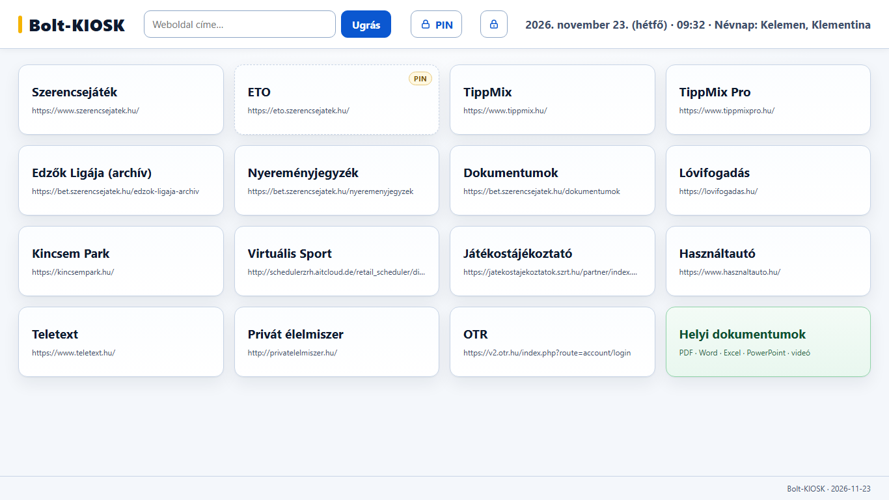
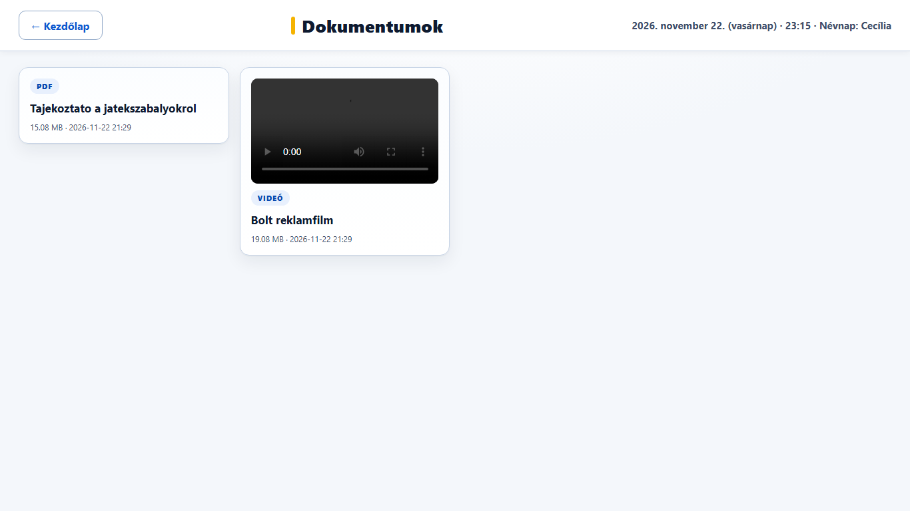
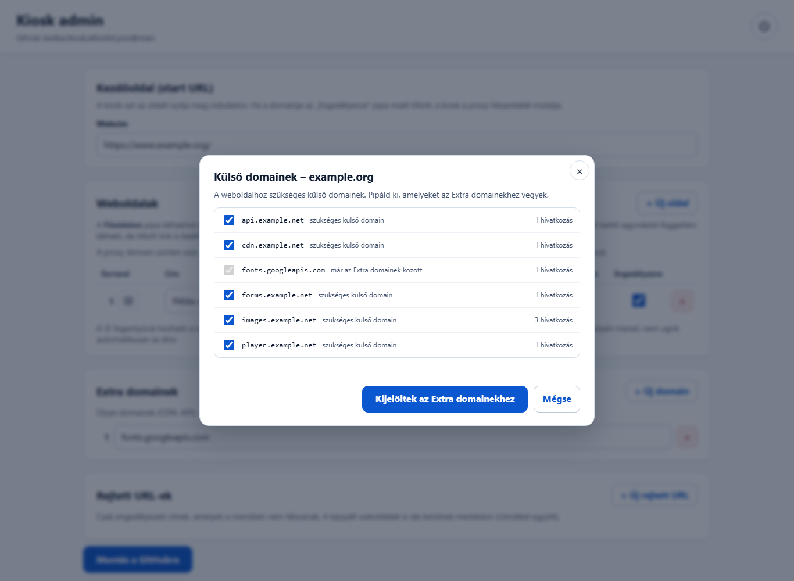
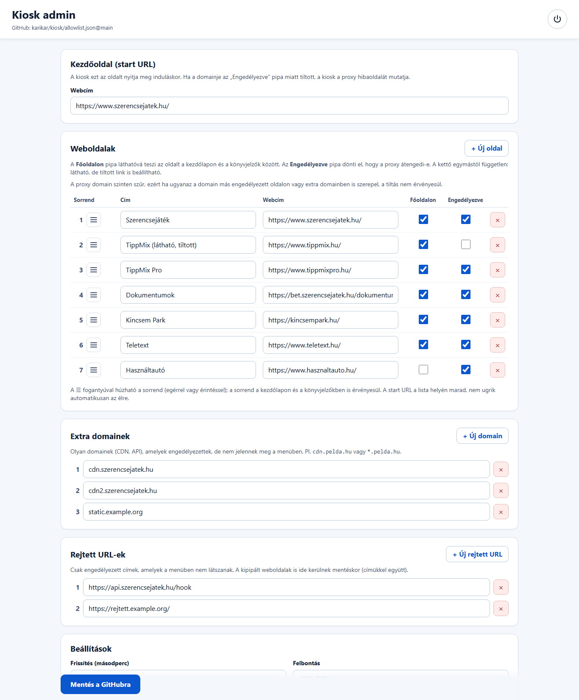

# Debian kiosk – Xorg nélküli, bash-alapú böngésző-kiosk

Minimalista kiosk rendszer Debian 12-re: **nincs Xorg, nincs asztali környezet,
nincs ablakkezelő**. Egyetlen Wayland kliens fut, a `cage` kiosk-compositorban
a Firefox ESR. A megengedett weboldalak listája egy **privát GitHub repóban**
él, a könyvjelzőmenü és a kezdőlap ebből generálódik.





> A képek a generált helyi kezdőlapot és dokumentumlistát mutatják (nem a
> Firefox saját felületét).

---

## Mit tud

| Követelmény | Megvalósítás |
|---|---|
| Debian, minimál, **Xorg nélkül** | Wayland + `cage` (wlroots, KMS/DRM), X11 nincs telepítve |
| Csak Firefox ESR | a session egyetlen kliense a `firefox-esr` |
| Bash (+ Python) | a kiosk logika bash; a helyi admin UI kiszolgálója python3 |
| Videó, PDF, Word, Excel, PowerPoint olvasása | PDF: Firefox pdf.js; Office: LibreOffice headless → PDF; videó: Firefox `<video>` |
| Engedélyezett oldalak privát GitHub repóban | `kiosk-sync.sh` + token, 10 percenként |
| Könyvjelzőmenü látható, tartalma a GitHub-lista | Firefox `Bookmarks` házirend + könyvjelzősáv |
| Nincs rendszermenü | nincs desktop/WM; a Firefox menüsor, címsor, tab-sáv elrejtve |
| Csak Vissza / Előre / Kezdőlap | `userChrome.css` + könyvjelzősáv |
| Böngésző bezárása → újraindul | `kiosk-session.sh` végtelen ciklus + getty autologin |
| Magyar nyelv és billentyűzet | hu locale, Firefox nyelvi csomag, XKB `hu` layout |
| Belépéskori jelentés (IP + időpont + napló) | `kiosk-login-report.sh` PAM-ból, feltöltés GitHubra |
| GitHub allowlist szerkesztő (PIN) | `admin.html` + `kiosk-admin-ui.service` |

---

## Hogyan működik

```
                    ┌─────────────────────────────────────────────┐
  GitHub (privát)   │  allowlist.json  (a "menü" forrása)         │
  karikar/kiosk ───▶│  kiosk-sync.service (10 percenként, root)   │
                    └───────────────┬─────────────────────────────┘
                                    │ jq validálás + normalizálás
                                    ▼
                    ┌─────────────────────────────────────────────┐
                    │ /var/lib/kiosk/state/allowlist.json (cache) │
                    └───────────────┬─────────────────────────────┘
                                    │ kiosk-render.sh
              ┌─────────────────────┼──────────────────────┐
              ▼                     ▼                      ▼
   /srv/kiosk/start.html   /etc/firefox-esr/policies   /etc/kiosk/proxy-filter
   (kezdőlap, csempék)      policies.json               (tinyproxy allowlist)
                                   │                      │
                                   ▼                      ▼
                    ┌──────────────────────┐   ┌──────────────────────┐
   tty1 autologin → │ kiosk-session.sh     │   │ kiosk-proxy.service  │
                    │  cage + firefox-esr  │──▶│  127.0.0.1:8877      │
                    │  (végtelen ciklus)   │   │  csak a listán lévők  │
                    └──────────────────────┘   └──────────────────────┘
```

- A **sync** rootként fut, a tokent csak ő látja. Hibánál a korábbi, működő
  lista marad érvényben (nincs „üres menü” üzemzavar).
- A **render** legyártja a kezdőlapot, a Firefox házirendet (benne a
  könyvjelzőkkel) és a proxy szűrőt.
- Ha a lista változott, a session a `/run/kiosk/restart` flaggel
  újraindítja a böngészőt (legfeljebb ~3 mp).
- A böngésző bezárása/lefagyása esetén a ciklus újraindítja. A `getty@tty1`
  autologin pedig akkor is visszahozza, ha maga a ciklus állna le.

---

## Követelmények

- Debian 12 (bookworm) vagy újabb, systemd-vel
- 64 bites CPU, legalább 2 GB RAM (LibreOffice miatt 4 GB ajánlott)
- Legalább egy Intel/AMD/NVIDIA GPU, amit a `wlroots`/`cage` KMS-en kezel
  (Intel és AMD a legbiztonságosabb választás)
- Internet a telepítéshez és a GitHub-szinkronhoz
- **Nem** kell: Xorg, desktop, böngészőn kívüli alkalmazások

---

## Telepítés

```bash
sudo bash install.sh
```

A telepítő bekérdezi a GitHub adatokat és a tokent, majd:

1. telepíti: `cage`, `firefox-esr`, `libavcodec-extra`, `pipewire`,
   LibreOffice (Writer/Calc/Impress), `tinyproxy`, `jq`, fontok;
2. létrehozza a `kiosk` rendszerfelhasználót;
3. telepíti a scripteket, systemd egységeket, udev szabályt;
4. beállítja a tty1 autologint;
5. letölti az allowlistet, legyártja a felületet;
6. elindítja a szolgáltatásokat és a böngészőt.

Telepítés utáni ellenőrzés:

```bash
kiosk-admin.sh status
kiosk-admin.sh test https://www.szerencsejatek.hu/   # átengedve?
kiosk-admin.sh test https://example.com/             # TILTVA?
```

> Ha SSH-n keresztül telepítesz, a böngésző a tty1-en indul, a telepítő
> konzolod nem szakad meg. Ha közvetlenül a tty1-en vagy root, a getty
> újraindítását külön kéri a telepítő.

### Fontos biztonsági lépés

A token **soha** ne kerüljön a repóba vagy a kiosk felhasználóhoz. A telepítő
`/etc/kiosk/github.token` néven, `root:root 0600` jogosultsággal tárolja, és a
curl `--config` fájlból olvassa (nem látszik a process listában).

Ha a token bármikor nyílt szövegben szerepelt (pl. régi `github.env`,
`Token_kiosk.txt`, chat, jegyzet), **cseréld le** a GitHubon, majd:

```bash
kiosk-admin.sh set-token
kiosk-admin.sh update
```

## Magyar nyelv és billentyűzet

A kiosk alapból **magyar nyelvű**:

- a telepítő `firefox-esr-l10n-hu` nyelvi csomagot tesz fel, és a
  `KIOSK_LANG=hu_HU.UTF-8` locale-t használja;
- a Firefox házirendben `intl.locale.requested=hu` és
  `intl.accept_languages=hu-HU, hu, en-US, en` van, így a böngésző menüi,
  hibaoldalai és a PDF-néző is magyarul jelennek meg;
- a saját oldalak (kezdőlap, dokumentumok, admin) és a CLI üzenetei eleve
  magyarok.

A **billentyűzet** a `hu` (magyar) layoutot használja:

- a `kiosk-session.sh` a cage/Wayland indulása előtt beállítja a
  `XKB_DEFAULT_LAYOUT=hu`, `XKB_DEFAULT_MODEL=pc105` (és az esetleges
  variant/options) környezeti változókat;
- a telepítő a konzolhoz is beírja a `/etc/default/keyboard` fájlt
  (`XKBLAYOUT="hu"`), és lefuttatja a `setupcon`-t.

Így az `áéíóöőúüű` karakterek a böngészőben, az admin PIN-mezőben és a
címbeviteli mezőben is bevihetők.

Módosítás a `/etc/kiosk/kiosk.conf`-ban:

```bash
KEYBOARD_LAYOUT=hu
KEYBOARD_MODEL=pc105
KEYBOARD_VARIANT=
KEYBOARD_OPTIONS=
```

Majd:

```bash
sudo kiosk-admin.sh restart      # a session újraindul az új XKB-beállítással
```

A konzolhoz (tty) külön:

```bash
sudo dpkg-reconfigure keyboard-configuration
# vagy: /etc/default/keyboard szerkesztése + sudo setupcon
```

Meglévő kiosk frissítése a magyar nyelvhez/billentyűzethez:

```bash
sudo apt-get install -y firefox-esr-l10n-hu xkb-data
sudo install -m 0755 bin/kiosk-session.sh /usr/local/bin/
sudo install -m 0644 lib/common.sh lib/policies.jq /usr/lib/kiosk/
sudo install -m 0644 firefox/user.js /usr/share/kiosk/firefox/
sudo kiosk-admin.sh render
sudo kiosk-admin.sh restart
```

> Érintőképernyőn nincs beépített on-screen billentyűzet; a beviteli mezőkhöz
> fizikai billentyűzet kell.

A tiltott oldalak hibaoldala is magyar: a tinyproxy
`DefaultErrorFile`-ja a [`proxy/error.html`](proxy/error.html) sablont
használja.

---

## GitHub allowlist (privát repó)

Ajánlott token: **fine-grained personal access token**, csak arra az egy
repóra, `Contents: Read-only` joggal. Semmi más jog nem kell.

A repóban egy JSON fájl (alapértelmezés: `allowlist.json` a `main` ágon).

### Séma A – „örökölt”, a jelenlegi repó formátuma

```json
{
  "start_url": "https://www.szerencsejatek.hu/",
  "allowed_domains": [
    "https://www.szerencsejatek.hu/",
    "https://www.tippmix.hu/"
  ],
  "allowed_prefixes": [
    "https://www.szerencsejatek.hu/",
    "https://www.tippmix.hu/"
  ],
  "refresh_interval_seconds": 300
}
```

Ebből a menücímek a domainből/útvonalból generálódnak
(pl. `bet.szerencsejatek.hu - Nyeremenyjegyzek`). A `hidden_urls` mező
(lásd lentebb) az örökölt sémában is használható.

### Séma B – szép menücímekkel (ajánlott)

```json
{
  "start_url": "https://www.szerencsejatek.hu/",
  "sites": [
    { "title": "Szerencsejáték", "url": "https://www.szerencsejatek.hu/" },
    { "title": "TippMix",        "url": "https://www.tippmix.hu/" },
    { "title": "Nyereményjegyzék", "url": "https://bet.szerencsejatek.hu/nyeremenyjegyzek" }
  ],
  "extra_domains": ["cdn.example.com"],
  "hidden_urls": ["https://api.example.org/hook"],
  "refresh_interval_seconds": 300,
  "resolution": "1366x768"
}
```

- A `start_url` az a cím, amit a kiosk megnyit. Ha a `sites` listában
  szerepel, a **helyén marad** (így az admin sorrendje érvényesül); ha
  hiányzik, elölre kerül.
- A `sites` elem opcionális `"allowed": false` mezője **látható, de tiltott**
  oldalt jelent: a csempe és a könyvjelző megjelenik, de a domain nem kerül a
  proxy allowlistjére. Domain szintű szűrés miatt, ha ugyanaz a domain máshol
  engedélyezett, a tiltás nem érvényesül.
- A `resolution` opcionális (`1366x768` alak); a session a cage indulásakor
  a `wlr-randr`-ral próbálja beállítani. Üresen hagyva automatikus.
- Az `extra_domains` akkor kell, ha egy engedélyezett oldal más domainről
  tölti a képet/fontot/API-t (CDN). `*.example.com` alak is használható.
- A `hidden_urls` elemei **csak a proxy allowlistjára** kerülnek: a beírt cím
  (teljes URL vagy csupasz domain) engedélyezve lesz, de a kezdőlapon és a
  könyvjelzők között **nem jelenik meg**. Így lehet például egy belső linket
  vagy API-t engedélyezni anélkül, hogy a kiosk menüjében látszana.
  ```json
  "hidden_urls": [
    "https://api.example.org/hook",
    "cdn2.example.net",
    { "title": "Belső oldal", "url": "https://belso.example.org/" }
  ]
  ```
  A `{ "title": "...", "url": "..." }` objektum alak is elfogadott; a `title`
  itt nem jelenik meg (a bejegyzés rejtett), csak a `url` számít.
  HTTPS-nél a szűrés domain szintű, tehát a megadott cím **domainje** (és
  aldomainjei) engedélyeződnek; az útvonal nem szűrhető. A `www.` itt is
  levágódik, a nagybetűk nem számítanak. Ellenőrzés:
  `kiosk-admin.sh status` (rejtett darabszám) és
  `kiosk-admin.sh test https://a-cim/`; a betöltött lista:
  `jq -r '.hidden_domains[]' /var/lib/kiosk/state/allowlist.json`.
- Csak `http://` és `https://` URL-ek fogadhatók el; max. 300 oldal.
- A `www.` levágásra kerül a domain-szűrésnél, tehát a `www.tippmix.hu` és a
  `tippmix.hu` ugyanazt jelenti, az aldomainek pedig öröklődnek.
- A `refresh_interval_seconds` mezőt a régi rendszerrel való kompatibilitás
  miatt megtartjuk; az ütemezést a `kiosk-sync.timer` adja (alapból 10 perc).

Kész, másolható példa: [`examples/allowlist.json`](examples/allowlist.json).
A régi formátumú lista is működik változtatás nélkül.

### Frissítés

- Automatikus: `kiosk-sync.timer`, 10 percenként (a telepítő írja be).
- Kézi:

```bash
kiosk-admin.sh update     # letöltés + render + böngésző újraindítás
kiosk-admin.sh urls       # mi van éppen betöltve
```

A letöltött lista a `/var/lib/kiosk/state/allowlist.json` fájlba kerül
(normalizálva). Ha a GitHub elérhetetlen, ez marad érvényben.

> Ha a lista **megváltozik**, a böngésző az új házirend érvénybe lépéséhez
> újraindul (legfeljebb ~3 mp). Éles üzemben ezért érdemes a lista módosítását
> nyitvatartási időn kívülre időzíteni.

---

## Amit a felhasználó lát

- **Kezdőlap**: világos csempés rács, kattintható óriásgombokkal; a fejlécben
  a dátum, a hét napja, az idő és az aznapi magyar névnap látszik
  (pl. `2026. november 22. (vasárnap) · 23:10 · Névnap: Cecília`), valamint
  egy **címbeviteli mező** („Ugrás”) a weboldalak gyors megnyitásához.
- **PIN gomb** a fejléc jobb oldalán: PIN után a proxy ideiglenesen
  **minden domaint** enged (alapból 15 percig), utána automatikusan visszazár.
- **Zár gomb** (lakat ikon) mellette: azonnal visszazárja a böngészést,
  PIN nélkül is.
- **Tiltott, de látható oldal**: a csempén **PIN** jelvény; kattintásra a
  PIN-ablak jön, és csak sikeres PIN után nyílik meg a cím.
- **Könyvjelzősáv**: `⌂ Kezdőlap` (arany gomb) + `Engedélyezett oldalak`
  mappa, ami legördülve a teljes listát mutatja. A mappát a Firefox
  `ManagedBookmarks` házirendje adja (egyetlen, csak olvasható mappa), így
  nem duplikálódhat; a Kezdőlap a `Bookmarks` házirendből jön.
- **Vissza / Előre** gomb a felső sávban (nagy, érintésbarát méret).
- Se címsor, se tab-sáv, se hamburger menü, se rendszermenü (a kezdőlap saját
  címbeviteli mezője kivétel).

A `⌂ Kezdőlap` egy könyvjelző, ami pontosan úgy viselkedik, mint egy home
gomb: a helyi kezdőlapra visz. A Firefox saját Home gombját a
`browser.toolbarbuttons.introduced.homeButton` beállítás is megpróbálja
megjeleníteni; ha ez a Firefox-verzióban nem működik, a könyvjelző akkor is
ott van.

## Világos / sötét téma

A kezdőlap, a dokumentumok oldal és az admin felület **bal felső sarkában**
van egy téma gomb:

- 🌙 – sötét témára vált;
- ☀ – világos témára vált.

A választás az admin szolgáltatás segítségével **minden oldalon és
újraindítás után is megmarad**; a téma állapota:

```text
/var/lib/kiosk/state/theme
```

A `theme.js` tölti be a témát, a CSS pedig a `data-theme="dark"`
attribútum alapján vált. Ha az admin szolgáltatás éppen nem érhető el,
a böngésző `localStorage`-a adja a visszaesést.

---

## Dokumentumok (PDF, Word, Excel, PowerPoint, videó)

A `/srv/kiosk/inbox` könyvtárba tett fájlokat a rendszer feldolgozza, majd a
kezdőlapon a **Helyi dokumentumok** csempén jelennek meg:

| Típus | Mi történik |
|---|---|
| PDF, TXT, MD, kép | változatlanul megnyílik a böngészőben |
| DOC/DOCX/ODT/RTF, XLS/XLSX/ODS/CSV, PPT/PPTX/ODP | LibreOffice headless → PDF, utána pdf.js |
| MP4/M4V/WEBM/MKV/MOV/AVI, MP3/WAV | beépített lejátszó `<video>`/`<audio>` |

Feltöltés USB-ről: dugj be egy USB-t, a udev szabály **csak olvashatóan**
csatolja, a támogatott fájlokat átmásolja, majd lecsatolja. A másolás után a
lista automatikusan frissül.

- Támogatott fájlok: PDF, TXT, MD, DOC/DOCX/ODT/RTF, XLS/XLSX/ODS/CSV,
  PPT/PPTX/ODP, MP4/M4V/WEBM/MKV/MOV/AVI/OGV, MP3/WAV/M4A,
  JPG/JPEG/PNG/GIF/WEBP/SVG/BMP.
- Legfeljebb 2 GB/fájl, legfeljebb 3 könyvtár mélységig.
- A fájlrendszer lehet FAT32, exFAT, NTFS vagy ext4.
- Ha nem indul el az import:

```bash
lsblk -o NAME,SIZE,FSTYPE,LABEL,MOUNTPOINTS
systemctl list-units 'kiosk-usb-import@*'
sudo journalctl -u 'kiosk-usb-import@*' -b --no-pager | tail -40
sudo /usr/local/bin/kiosk-usb-import.sh /dev/sdX1
sudo kiosk-admin.sh docs
```

Kézi feldolgozás:

```bash
sudo cp valami.docx /srv/kiosk/inbox/
sudo kiosk-admin.sh docs
```

### Feltöltés a szerveroldali inboxból

A dokumentumkezelő **nem használ natív fájlválasztót** (Browse), mert a
cage alatt az megakadhat. Helyette a szerveroldali inboxot listázza.

1. Másold a fájlt a kioskra USB-ről, vagy SSH-val az inboxba:

```bash
scp valami.pdf admin@<kiosk-ip>:/tmp/
ssh admin@<kiosk-ip> 'sudo install -m 0644 /tmp/valami.pdf /srv/kiosk/inbox/'
```

2. A **Helyi dokumentumok** oldalon nyisd meg a **„Dokumentumok kezelése
   (PIN)”** részt, és add meg a PIN-t.
3. **Beérkezők frissítése** – itt látod a még nem feldolgozott fájlokat.
4. **Beérkezők feldolgozása** – lefut a dokumentumfeldolgozó; a fájlok a
   dokumentumtárba kerülnek, az Office-fájlokból PDF készül.
5. A **Dokumentumok** listában a **Törlés** gombbal eltávolítható a kész
   dokumentum; a **Beérkezők** listában a **Törlés** csak az inboxból veszi ki.

Ha a `kiosk-docs.path` a fájlt már automatikusan feldolgozta, az nem a
Beérkezők, hanem a Dokumentumok listában látszik. A Beérkezők lista az
éppen még feldolgozatlan fájlokat mutatja.

Ha mindenképp a Beérkezők listából akarsz feldolgozni, kapcsold ki az
automatikus path unitot:

```bash
sudo systemctl disable --now kiosk-docs.path
```

Ezután a beérkező fájlok megvárják a **Beérkezők feldolgozása** gombot.
Az USB-import továbbra is azonnal feldolgoz.

A feldolgozás maximális fájlmérete 2 GB; a törlés a `/srv/kiosk/docs`
fájlt és a hozzá tartozó feldolgozott eredetit is eltávolítja, majd
újragenerálja a listát.

### Ha a fájl nem jelenik meg a Beérkezők között

- Ellenőrizd a jogosultságot és a helyet:

```bash
ls -l /srv/kiosk/inbox
sudo kiosk-admin.sh docs
```

- Ha a path unit már lefutott, a fájl a `/srv/kiosk/docs` alatt van.
- SSH-val az admin felhasználóval dolgozz, majd `sudo`-val másolj az
  inboxba (a `kiosk` felhasználónak nincs jelszava).

Korlátok:

- Az Office → PDF átalakítás **olvasásra** jó, nem pixelpontos Word-megjelenés.
- USB-ről a fájlok egyszer másolódnak be, utána a `/srv/kiosk/docs` a
  dokumentumtár. Nagy videóknál nézd a szabad helyet.
- A Firefox H.264/AAC lejátszáshoz a `libavcodec-extra` csomag kell (telepítve).

---

## Hálózati allowlist (proxy)

Alapból bekapcsolva: a Firefox egy helyi `tinyproxy`-n megy keresztül, ami
**default deny** módon csak a listán szereplő domaineket engedi át. Így a
könyvjelzőkön kívül a linkekre kattintva sem lehet más oldalra menni.
A szűrés **domain-alapú** (`FilterType ere`, `FilterDefaultDeny Yes`); a
`FilterURLs` direktívát szándékosan nem használjuk, mert a tinyproxy 1.11-ben
az HTTPS-nél nem működik.

A `hidden_urls` listán szereplő címek is engedélyezettek a proxyban, de a
kezdőlapon és a könyvjelzők között **nem jelennek meg** (lásd a sémát fentebb).
Ugyanezt teszi a helyi `kiosk-admin.sh allow` is (helyi rejtett lista), míg az
admin felület (Ctrl+Alt+A) a GitHub allowlistet szerkeszti. A
`localhost`/`127.0.0.1` kimarad a proxyból, hogy a helyi admin oldal elérje a
szolgáltatást; ez csak a helyi gépre vonatkozik, a külső allowlistet nem érinti.

> A tinyproxy a szűrőfájl minden sorát az első **escapeletlen `#`** karakterig
> megjegyzésként levágja (a sor belsejében is). A generált minták ezért nem
> tartalmaznak `#`-et; ha kézzel szerkeszted a `/etc/kiosk/proxy-filter`
> fájlt, ezt tartsd szem előtt, különben a proxy „Bad regex” hibával nem indul.

```bash
kiosk-admin.sh test https://www.tippmix.hu/   # átengedve
kiosk-admin.sh test https://facebook.com/     # TILTVA (403)
```

Kikapcsolás (ha egy oldal CDN-jei miatt túl szigorú):

```bash
sudo sed -i 's/^ENFORCE_ALLOWLIST=.*/ENFORCE_ALLOWLIST=0/' /etc/kiosk/kiosk.conf
sudo systemctl disable --now kiosk-proxy.service
sudo kiosk-admin.sh render
```

Fontos korlát: **HTTPS-nél a proxy csak a domain/IP látszik**, az útvonal
(pl. `/dokumentumok`) nem szűrhető. A lista útvonalai tehát a menüt és a
kezdőlapot vezérlik, a hálózati tiltás domain szintű. Ha egy oldal több
CDN-t használ, vedd fel őket az `extra_domains` listára.

---

## Belépéskori jelentés (opcionális)

Minden belépéskor (konzol/autologin és SSH is) a kiosk egy **nyilvános
IP-címet, egy ISO 8601 időpontot és egy naplófájlt** tölt fel a megadott
GitHub repóba, így távolról is látszik, mikor és honnan indult a gép.

A feltöltött fájl útja:

```
login-logs/<hostname>/<ÉÉÉÉ-HH-NN>/<ÓÓPPMMSS>-<felhasználó>.log
```

A `.log` fejlécében ott van az IP és az időpont, utána a kiosk egységek
utolsó 200 naplósora (`journalctl -b`) és az esetleg meghibásodott systemd
egységek listája. A feltöltés a GitHub **Contents API**-val történik, egy
commitként; a commit üzenete is tartalmazza a gazdagépet, az időpontot és az
IP-t.

> **Adatvédelem:** a célrepó legyen **privát**, mert a napló üzemeltetési
> információkat (IP, felhasználónév, hibák) tartalmaz. A jelentés küldését
> csak akkor kapcsold be, ha ezt a helyi szabályok engedik.

### Beállítás

A jelentéshez **külön token** kell (a csak olvasható allowlist token nem
elég): fine-grained PAT, `Contents: Read and write` joggal, csak a célrepóra.
A token a `/etc/kiosk/report.token` fájlban van (`root:root`, `0600`), a kiosk
felhasználó nem látja.

```bash
# /etc/kiosk/kiosk.conf
REPORT_ENABLED=1
REPORT_GITHUB_OWNER=karikar
REPORT_GITHUB_REPO=kiosk
REPORT_GITHUB_REF=main
REPORT_PATH=login-logs
REPORT_TOKEN_FILE=/etc/kiosk/report.token
REPORT_LOG_LINES=200
```

Telepítéskor a kérdésre `i`-vel lehet bekapcsolni, vagy nem interaktívan:

```bash
sudo REPORT_ENABLED=1 REPORT_TOKEN=github_pat_... bash install.sh
```

Ha később kapcsolod be, a PAM-profilt is telepíteni kell:

```bash
sudo install -m 0644 pam/kiosk-login-report /usr/share/pam-configs/kiosk-login-report
sudo pam-auth-update --enable kiosk-login-report
```

A kiosk autologinja is a `login` PAM-szolgáltatáson megy át, ezért a
jelentés minden bootkor (az automatikus belépéskor) lefut.

### Működés és próba

A jelentést a PAM `open_session` hívja (`login`, `sshd`), de a szkript
azonnal visszaadja a vezérlést, a tényleges munka systemd tranziens
unitként fut a háttérben – a bejelentkezést lassú hálózat esetén sem
blokkolja. Hálózati hiba esetén néhányszor újrapróbálja, majd naplóz és
kilép; a login mindenképp sikeres marad.

```bash
sudo kiosk-admin.sh report --dry-run   # csak kiírja, mit töltene fel
sudo kiosk-admin.sh report             # azonnali feltöltés
journalctl -u 'kiosk-login-report-*' -n 30 --no-pager
```

Kikapcsolás:

```bash
sudo sed -i 's/^REPORT_ENABLED=.*/REPORT_ENABLED=0/' /etc/kiosk/kiosk.conf
sudo pam-auth-update --remove kiosk-login-report
sudo rm -f /usr/share/pam-configs/kiosk-login-report
```

---

## Admin felület (GitHub allowlist szerkesztő)

A kioskon a **Ctrl+Alt+A** billentyűkombináció megnyitja az admin oldalt, ahol
először egy **PIN-kódot kérő felugró ablak** jelenik meg. Sikeres PIN után a
`karikar/kiosk/allowlist.json` szerkeszthető:

- **Kezdőoldal (start URL)** – a kiosk induló oldala;
- **Weboldalak** – cím, webcím, és két, egymástól független pipa:
  - **Főoldalon**: bepipálva a `sites` listába kerül (kezdőlap +
    könyvjelzők), kipipálva a `hidden_urls` listába (rejtett);
  - **Engedélyezve**: bepipálva a domain bekerül a proxy allowlistjére,
    kipipálva **nem** (a link ettől még látható lehet a főoldalon, de a
    proxy tiltani fogja);
  - ha mindkettő ki van pipálva, a sor nem kerül mentésre;
- **Duplikáció** – a mentés elutasítja az azonos webcímet, extra domaint és
  rejtett URL-t (valamint a weboldal/rejtett lista közötti ismétlődést);
- **Látható, de tiltott oldal** – a csempén **PIN** jelvény van; kattintásra
  PIN-ablak jön, és csak sikeres PIN után nyílik meg. A könyvjelzője szintén
  a helyi PIN-oldalra mutat, nem a tiltott címre.
- **Külső domainek keresése** – a weboldal URL mezője mellett 🔍 gomb; új
  sornál a cím megadása után automatikusan felugrik. A popup a HTML/CSS-ben
  talált, a saját domainen kívüli hostokat listázza, checkboxokkal. A
  kijelöltek az **Extra domainek** közé kerülnek; a már meglévő/engedélyezett
  domainek letiltva jelennek meg, duplikáció nem kerül be.



A keresés **best-effort**: a HTML-ben és a hivatkozott CSS-ekben talált
asset-hostokat gyűjti (script, link, img, iframe, style, form, meta).
A JavaScript futás közben betöltött vagy beágyazott iframe-en belüli
domaineket nem feltétlenül látja; ilyenkor kézzel kell felvenni.

Ha a céloldal **HTTP 403/Cloudflare** botvédelmet ad, a szerveroldali
keresés nem tud átmenni a challenge-en (nincs JS/cookie). Ilyenkor a
böngészőben a **Ctrl+U** forrásból, vagy a proxy naplójából
(`journalctl -u kiosk-proxy | grep denied`) olvasd ki a szükséges
domaineket, és vedd fel kézzel az Extra domainek közé.
- **Sorrend** – a sorok sorszámozottak; a **☰ fogantyúval** húzhatók
  (egérrel/érintéssel), billentyűzettel `ArrowUp`/`ArrowDown` mozgatja.
  A sorrend a kezdőlapon és a könyvjelzőkben is érvényesül.
- **Extra domainek** – CDN/API domainek, amelyek nem jelennek meg a menüben;
- **Rejtett URL-ek** – további engedélyezett, de nem látható címek;
- az **Extra domainek** és **Rejtett URL-ek** sorai is sorszámozottak.
- **Frissítés (másodperc)** – a `refresh_interval_seconds` értéke;
- **Felbontás** – pl. `1366x768`; üres = automatikus. A kiosk a
  `wlr-randr`-ral próbálja beállítani a kimenetet (hardverfüggő);
- jobb felül a **kikapcsoló ikon** – „Újraindítás” és „Kikapcsolás” gomb.

A proxy **domain szinten** szűr, ezért ha ugyanaz a domain egy másik
engedélyezett oldalon vagy az `extra_domains` között is szerepel, a kipipált
tiltás nem érvényesül (a domain akkor is átmegy). Az admin mentés ezt
**elutasítja** ilyen ütközésnél, hogy ne legyen csendben hatástalan tiltás.

A **Mentés a GitHubra** gomb a GitHub Contents API-val írja vissza a fájlt,
majd elindítja a szinkront. A mentéshez külön, **Contents: Read and write**
jogú token kell:

```bash
sudo kiosk-admin.sh set-write-token
```

A token a `karikar/kiosk` repóra szóljon, **Contents: Read and write**
joggal (fine-grained PAT). A token a `/etc/kiosk/github-write.token` fájlban
él (`root:root`, `0600`), a böngésző soha nem látja. Write token nélkül az
oldal csak olvasni tud, és figyelmeztet a mentésnél.



- A felbontás a `resolution` mezőbe kerül; a session a következő
  cage-indításkor (mentés után a szinkron által kért újraindításkor) alkalmazza.
- A PIN nem sima szövegként, hanem salted SHA-256 hash-ként él a
  `/etc/kiosk/admin.pin` fájlban (`root:root`, `0600`). A szolgáltatás a
  `127.0.0.1:8878` címen hallgat, csak `X-Kiosk-Admin: 1` fejlécű kéréseket
  fogad, és a hibás PIN-próbákat korlátozza.
- A GitHubra írás a szolgáltatáson keresztül történik; a write token csak
  root számára olvasható.

Meglévő kiosk frissítése az új admin felülethez:

```bash
sudo apt-get install -y wlr-randr
sudo install -m 0755 bin/kiosk-admin-ui.py bin/kiosk-session.sh \
    bin/kiosk-set-resolution.sh bin/kiosk-admin.sh /usr/local/bin/
sudo install -m 0644 lib/common.sh lib/allowlist.jq lib/render.sh /usr/lib/kiosk/
sudo install -m 0644 web/admin.html web/unlock.html web/style.css web/clock.js \
    /usr/share/kiosk/web/
sudo kiosk-admin.sh set-write-token     # Contents: Read and write token
sudo kiosk-admin.sh render
sudo systemctl restart kiosk-admin-ui.service
sudo kiosk-admin.sh restart
```

A `systemd/kiosk-admin-ui.service` új verziója csak akkor kell, ha a
`GITHUB_*` értékeket a unitban is át akarod adni; a szolgáltatás alapértékei
a `karikar/kiosk/allowlist.json@main` címre mutatnak.

### PIN beállítása

Telepítéskor a „Admin PIN az admin felülethez” kérdésre adott
4–8 számjegyű PIN-nel kapcsol be. Utólag:

```bash
sudo kiosk-admin.sh set-pin
```

### Parancssorból (SSH-n)

A CLI továbbra is a **helyi** rejtett/látható listát kezeli (nem a GitHubot):

```bash
sudo kiosk-admin.sh allow https://pelda.hu/oldal   # helyi, rejtett engedélyezés
sudo kiosk-admin.sh hidden                        # helyi rejtett domainek
sudo kiosk-admin.sh unallow pelda.hu              # helyi törlés
```

A GitHub allowlistet az admin felület (Ctrl+Alt+A) szerkeszti.

### Kikapcsolás

```bash
sudo systemctl disable --now kiosk-admin-ui.service
sudo rm -f /etc/kiosk/admin.pin
```

A helyi engedélyezések ettől még érvényben maradnak; törlésükhöz
`kiosk-admin.sh unallow <host>`, vagy a `hidden-urls.local` ürítése és
`kiosk-admin.sh render`.

---

### PIN-es gyors feloldás (főoldali gomb)

A kezdőlap fejlécében a **PIN** gomb egy felugró PIN-ablakot nyit. Helyes PIN
után a proxy **ideiglenesen minden domaint átenged** (a `Filter*` sorok
kikerülnek a tinyproxy konfigból), így szabadon lehet böngészni. Az
időtartam alapból **15 perc** (`PROXY_BYPASS_MINUTES`), utána a szolgáltatás
automatikusan visszazárja a proxyt. A feloldás a `/run/kiosk/proxy-bypass`
fájlban van; újraindítás után természetesen zárva indul.

- A feloldás a **PIN-es** admin felülettől független: itt nincs GitHub-írás,
  csak ideiglenes proxy-bypass.
- A mellette lévő **lakat ikonnal** (vagy a PIN-ablak „Visszazárás” gombjával)
  a szabad böngészés **azonnal megszakítható**, PIN nélkül is.
- A `kiosk-sync`/render a bypass ideje alatt is nyitva hagyja a proxyt, a
  lejárat után viszont visszaállítja az allowlistet.
- `kiosk-admin.sh status` kiírja, ha aktív, és mennyi van hátra.
- A PIN-t ne add ki; a rövid időkorlát csökkenti a visszaélés kockázatát.
- Az időtartam a unitban van (`ADMIN_BYPASS_MINUTES`); módosítás után:
  ```bash
  sudo systemctl edit kiosk-admin-ui.service
  sudo systemctl daemon-reload
  sudo systemctl restart kiosk-admin-ui.service
  ```

## SSH

Az `openssh-server` az ISO alaprészében és a normál `install.sh`-ban is
települ. A firstbootnál megadott **admin felhasználóval** lehet belépni:

```bash
ssh admin@<kiosk-ip-címe>
```

A jelszó a firstbootnál megadott admin jelszó. A kiosk a saját `kiosk`
rendszerfelhasználóval fut, annak nincs jelszava és nincs `sudo`-ja.

A telepítő ezt a konfigurációt teszi be
(`/etc/ssh/sshd_config.d/10-kiosk.conf`):

```text
PermitRootLogin no
PasswordAuthentication yes
KbdInteractiveAuthentication no
UsePAM yes
X11Forwarding no
AllowAgentForwarding no
```

Az SSH a **22/tcp** porton figyel. Ha a gép nyilvános hálózaton van,
korlátozd tűzfallal, és használj erős admin jelszót. Root SSH belépés
nincs; a `kioskadmin` helyett a firstbootnál megadott név használható.

## Kiosk zár / korlátozások

- Nincs Xorg, nincs desktop, nincs terminál-emulátor a kiosk felhasználónak.
- A `kiosk` felhasználó jelszava zárolt, `sudo`-ja nincs.
- Firefox házirend (policies.json) tiltja: frissítés, telemetria, about:config,
  about:addons, about:profiles, about:support, fejlesztői eszközök, privát
  böngészés, jelszókezelő, nyomtatás, extension telepítés.
  (Nyomtatás kell? A `lib/policies.jq`-ban állítsd `PrintingEnabled: true`-ra,
  majd `kiosk-admin.sh render`.)
- A menüsor, címsor, tab-sáv el van rejtve; a jobb klikk menü kikapcsolva.
- A `cage` alapból nem engedi a VT-váltást (`-s` kapcsoló engedné).
- A `systemd-logind` a power gombra kikapcsol, idle-re nem suspendál.

Ami **nem** kiosk-zár, csak korlátozás:

- Fizikai hozzáférésnél a tty2-n (Ctrl+Alt+F2) megjelenhet egy bejelentkező
  prompt; jelszó nélkül nem lehet bejutni, de a prompt látszik. Ha ez sem
  kell, a `NAutoVTs=1` beállítással eltüntethető.
- SSH alapból **nincs** telepítve. Távoli karbantartáshoz (éles üzem előtt
  érdemes beállítani):

  ```bash
  sudo apt install openssh-server
  sudo install -d /etc/ssh/sshd_config.d
  echo 'DenyUsers kiosk' | sudo tee /etc/ssh/sshd_config.d/99-kiosk.conf
  sudo systemctl enable --now ssh
  ```

  Root belépéshez kulcsot használj (`PermitRootLogin prohibit-password`),
  vagy állíts be erős root jelszót a konzolos karbantartáshoz.
- **Érintőképernyő**: a kiosk kezeli az érintést (libinput), de beépített
  on-screen billentyűzet nincs. Bejelentkező űrlapokhoz (pl. OTR) fizikai
  billentyűzet szükséges, vagy külön Wayland OSK telepíthető.

---

## Program önfrissítés (GitHub Releases)

A telepített kiosk magától frissül, ha a program GitHub-repójában új
**kiadás (release)** jelenik meg. A `kiosk-update.timer` óránként (és
bootolás után 10 perccel) lefuttatja a `kiosk-update.sh`-t:

```
GitHub: v1.2.0 tag ──▶ release workflow ──▶ Release: debian-kiosk-1.2.0.tar.gz (+ .sha256)
                                                       │
  kiosk-update.timer (óránként) ──▶ kiosk-update.sh ◀──┘  /releases/latest
     1. újabb, mint /usr/share/kiosk/VERSION?   (nem → kilép)
     2. letöltés + SHA-256 + VERSION egyezés + bash -n ellenőrzés
     3. /opt/kiosk-setup/releases/1.2.0/install.sh  (frissítő mód)
     4. siker → current → 1.2.0, a böngésző újraindul
        hiba  → az előző kiadás install.sh-ja visszaállít; a hibás verziót
                megjegyzi (update-failed), nem próbálja óránként újra
```

- A frissítés **megtartja** a `/etc/kiosk/kiosk.conf` beállításait, a
  tokeneket, az admin PIN-t, a helyi rejtett/látható listákat és az
  allowlist cache-t. Frissítő módban (`KIOSK_UPGRADE=1`) az `install.sh`
  semmit nem kérdez.
- Csak a `releases/latest` számít: **draft** és **pre-release** kiadást
  nem telepít, és **visszalépni** (downgrade) sem fog.
- Alapból csak `.sha256`-tal ellátott csatolmányt fogad el
  (`UPDATE_REQUIRE_CHECKSUM=1`); a csatolmányokat a release workflow
  automatikusan elkészíti.
- **Hol látszik a verzió:** a kezdőlap láblécében (`… · verzió 1.2.0`), az
  admin felület fejlécében (a legújabb kiadással és a frissítés állapotával:
  naprakész / frissítés elérhető / frissítve / hiba), valamint a
  `kiosk-admin.sh status` és `kiosk-admin.sh version` kimenetében. Frissítés
  után a kezdőlap azonnal újragenerálódik, így az új szám rögtön látszik.
- A telepítés újraindítja a böngészőt (a getty-t). Ha ez nyitvatartásban
  zavaró, állíts be karbantartási ablakot: `UPDATE_WINDOW=02-05`
  (02:00–04:59); az ellenőrzés ettől még óránként fut.
- A futás naplója: `journalctl -u kiosk-update.service`, a telepítő teljes
  kimenete: `/var/log/kiosk-update.log`.

Beállítás (`/etc/kiosk/kiosk.conf`, a telepítő kérdezi is):

```bash
UPDATE_ENABLED=1
UPDATE_GITHUB_OWNER=karikar
UPDATE_GITHUB_REPO=KioskClient
UPDATE_TOKEN_FILE=/etc/kiosk/update.token   # csak privát repóhoz
UPDATE_INTERVAL_MINUTES=60
UPDATE_WINDOW=                              # pl. 02-05, üres = bármikor
UPDATE_REQUIRE_CHECKSUM=1
```

Az `UPDATE_INTERVAL_MINUTES` módosítása után `sudo bash
/opt/kiosk-setup/current/install.sh` (vagy a következő frissítés) írja újra a
timert.

**Privát repó** esetén kell egy fine-grained token, csak erre a repóra,
`Contents: Read-only` joggal (az allowlist tokenje is jó, ha arra a repóra is
szól):

```bash
sudo kiosk-admin.sh set-update-token
```

**Azonnali frissítés az admin felületről:** Ctrl+Alt+A → PIN →
„Programfrissítés” kártya → **Frissítés keresése**, majd **Frissítés most**.
A frissítés külön systemd unitban fut (túléli az admin szolgáltatás
újraindulását), és a karbantartási ablakot nem várja meg. Néhány perc
múlva a böngésző újraindul, és a láblécben az új verzió látszik.

Kézi parancsok (SSH):

```bash
sudo systemctl start kiosk-update.service  # frissítés most, SSH-megszakadás ellen védve
sudo kiosk-admin.sh version              # telepített + legutóbbi kiadás
sudo kiosk-admin.sh self-update --check  # csak ellenőrzés
sudo kiosk-admin.sh self-update          # frissítés most (ha van újabb)
sudo kiosk-admin.sh self-update --dry-run  # letölt és ellenőriz, nem telepít
sudo kiosk-admin.sh self-update --force  # újratelepítés / hibásnak jelölt verzió
sudo systemctl list-timers kiosk-update.timer
```

Kikapcsolás:

```bash
sudo sed -i 's/^UPDATE_ENABLED=.*/UPDATE_ENABLED=0/' /etc/kiosk/kiosk.conf
sudo systemctl disable --now kiosk-update.timer
```

### Új verzió kiadása (fejlesztői oldal)

1. Írd át a `debian-kiosk/VERSION` fájlt (pl. `1.2.0`), és commitold.
2. Tageld és töltsd fel:

   ```bash
   git tag v1.2.0
   git push origin main v1.2.0
   ```

3. A `.github/workflows/release.yml` lefuttatja a teszteket, elkészíti a
   `debian-kiosk-1.2.0.tar.gz` + `.sha256` csomagot (`tools/make-release.sh`),
   és létrehozza a GitHub Release-t. A kioskok egy órán belül frissülnek.

A tagnek (`v1.2.0`) és a `VERSION` fájlnak egyeznie kell, különben a
workflow és a kioskok is elutasítják. Kézi kiadásnál a
`tools/make-release.sh` kimenetét (mindkét fájlt) csatold a release-hez.

---

## Karbantartás

```bash
kiosk-admin.sh status        # állapot, allowlist, szolgáltatások
kiosk-admin.sh update        # GitHub szinkron most
kiosk-admin.sh render        # felület újragenerálása cache-ből
kiosk-admin.sh restart       # böngésző újraindítása
kiosk-admin.sh docs          # inbox feldolgozása
kiosk-admin.sh urls          # engedélyezett oldalak
kiosk-admin.sh set-token     # token csere (nem látszik a bevitel)
kiosk-admin.sh logs 100      # napló
```

Naplók:

```bash
journalctl -t kiosk-sync -t kiosk-session -t kiosk-docs -t kiosk-usb -f
```

Megjelenés (színek, betűk): a helyi oldalak forrása a `web/style.css`, a
böngésző-kereté (felső sáv, könyvjelzősáv, menük) a `firefox/userChrome.css`.
Telepített rendszeren a fájlok cseréje után:

```bash
sudo install -m 0644 web/style.css /usr/share/kiosk/web/style.css
sudo install -m 0644 web/clock.js /usr/share/kiosk/web/clock.js
sudo install -m 0644 web/admin.html /usr/share/kiosk/web/admin.html
sudo install -m 0644 firefox/userChrome.css /usr/share/kiosk/firefox/userChrome.css
sudo kiosk-admin.sh render
sudo kiosk-admin.sh restart     # a userChrome.css a session indulásakor másolódik
sudo systemctl restart kiosk-admin-ui.service
```

A téma világos, nagy kontrasztú: a linkek kékek és aláhúzottak, a kártyák
fehér hátterűek. A Firefox felső sávja és könyvjelzőmenüje is világos, sötét
ikonokkal és feliratokkal, így napfényes helyiségben és gyengébb kijelzőn is
minden látható.

A fejléc dátumát, a hét napját, az időt és az aznapi névnapot a
[`web/clock.js`](web/clock.js) állítja elő. A névnapadatok forrása a
[sbolch/name-days](https://github.com/sbolch/name-days) adatbázis (MIT),
a magyar naptár szerint javított februári napokkal; szökőévben a
„Mátyás ugrása” szabály érvényes (február 24. szökőnap, a 24–28. névnapjai
egy nappal későbbre tolódnak).

---

## Hibaelhárítás

**Fekete képernyő, nincs böngésző**

```bash
systemctl status getty@tty1
journalctl -t kiosk-session -n 50
ls -l /dev/dri/
id kiosk          # video, render, input csoportok
```

A `cage` csak működő KMS/DRM mellett indul. VirtualBox/VM alatt gyakran nem
megy; ott `WLR_RENDERER=pixman` környezeti változóval próbálkozhatsz.

**A böngésző nem a kezdőlapot nyitja**

```bash
cat /etc/firefox-esr/policies/policies.json | jq .policies.Homepage
```

**A könyvjelzők nem frissülnek**

A session indításkor törli a `places.sqlite`-ot, és a házirendből építi újra
a könyvjelzőket. Ha mégsem:

```bash
kiosk-admin.sh update
sudo systemctl restart getty@tty1
```

**Egy oldal nem tölt be (proxy 403)**

```bash
kiosk-admin.sh test https://az-oldal.hu/
```

Ha a HTML betölt, de a kép/font nem: vedd fel a CDN domaint az
`extra_domains` listára, majd `kiosk-admin.sh update`.

**A proxy nem indul („proxy server is refusing connections” / Bad regex)**

```bash
kiosk-admin.sh doctor
journalctl -u kiosk-proxy -n 30 --no-pager
grep -n '#' /etc/kiosk/proxy-filter   # csak a fejléc-sorokban lehet '#'
```

A tinyproxy a szűrőfájl sorait az első escapeletlen `#`-nél megjegyzésként
levágja. Ha a levágott sor érvénytelen regex, a proxy el sem indul
(`Bad regex in /etc/kiosk/proxy-filter: line N`). A generált fájl ezért nem
tartalmaz `#`-et; kézi szerkesztés után:

```bash
sudo kiosk-admin.sh render
sudo systemctl restart kiosk-proxy
```

**Az `update` „nem érvényes JSON” hibát ad**

A GitHubról letöltött fájl nem JSON (sérült, üres, HTML vagy BOM-os). Az új
`kiosk-sync.sh` a hiba naplójában kiírja a méretet, a `Content-Type`-ot, a
jq hibát és a fájl első 200 karakterét. Kézi ellenőrzés (a token nem kerül
a parancssorba):

```bash
sudo bash -c '
  . /etc/kiosk/kiosk.conf
  token=$(cat /etc/kiosk/github.token)
  cfg=$(mktemp); chmod 600 "$cfg"
  printf "header = \"Authorization: Bearer %s\"\n" "$token" >"$cfg"
  curl -sS -D /tmp/gh.h \
    -H "Accept: application/vnd.github.raw+json" \
    -H "X-GitHub-Api-Version: 2022-11-28" \
    --config "$cfg" \
    "https://api.github.com/repos/${GITHUB_OWNER}/${GITHUB_REPO}/contents/${GITHUB_PATH}?ref=${GITHUB_REF}" \
    -o /tmp/allowlist.raw
  rm -f "$cfg"
  head -n 15 /tmp/gh.h
  wc -c /tmp/allowlist.raw
  head -c 300 /tmp/allowlist.raw | cat -A
  jq . /tmp/allowlist.raw >/dev/null && echo "JSON OK" || echo "JSON HIBA"
'
```

- **Szerkesztési hiba** (vessző, komment, hiányzó idézőjel): javítsd a
  GitHubon, majd `sudo kiosk-admin.sh update`.
- **UTF-8 BOM** (Windows Notepad): mentsd BOM nélkül; az új sync amúgy is
  leveszi.
- **Üres fájl / rossz ág vagy útvonal**: ellenőrizd a `GITHUB_PATH`-t és a
  `GITHUB_REF`-et.
- **HTML válasz** (`Content-Type: text/html`): captive portal vagy proxy
  válaszolt a GitHub helyett; próbáld más hálózaton, vagy engedélyezd a
  `api.github.com` elérését.

**Egy oldal YouTube-ja nem tölt be / „SSL Certificate” hiba**

Az ilyen üzenet leggyakrabban **félrevezető**: a weboldal a YouTube iframe API
hibáját írja ki „SSL Certificate” szöveggel. Először azt kell eldönteni, hogy
a hiba a weboldal szerverén vagy a kioskon keletkezik.

```bash
# A hibaüzenet benne van-e a szerver által küldött HTML-ben?
curl -s https://kincsempark.hu/ | grep -i -C2 'youtube api'

# A YouTube domainek átmennek-e a proxy allowlisten?
sudo kiosk-admin.sh test https://www.youtube.com/iframe_api
sudo kiosk-admin.sh test https://www.googleapis.com/
sudo kiosk-admin.sh test https://i.ytimg.com/

# Proxy nélkül, közvetlenül
curl -vI https://www.youtube.com/iframe_api
```

- Ha a HTML-ben benne van az üzenet: a weboldal **szerveroldali** YouTube
  modulja hibázik (saját CA/kulcs/kvóta); a kiosk nem tudja megjavítani,
  jelezni kell az oldal üzemeltetőjének.
- Ha a `kiosk-admin.sh test` **403**-at ír: a domainek hiányoznak az
  allowlistből. Vedd fel az **Extra domainek** közé (admin felület vagy
  `allowlist.json`):
  ```
  youtube.com
  youtube-nocookie.com
  googleapis.com
  gstatic.com
  ytimg.com
  googlevideo.com
  ```
  A `youtube.com` az apexet és az összes aldomaint engedi, így a
  `www.youtube.com/iframe_api`, a `consent.youtube.com` stb. is megy.
  Mentés után `kiosk-admin.sh update` (vagy az admin felületen mentés),
  majd töltsd újra az oldalt.
- Ha a közvetlen `curl` is tanúsítványhibát ír:
  ```bash
  timedatectl
  sudo apt update && sudo apt install --only-upgrade ca-certificates firefox-esr
  sudo update-ca-certificates
  openssl s_client -connect www.youtube.com:443 -servername www.youtube.com \
    </dev/null 2>/dev/null | openssl x509 -noout -issuer -dates
  ```
  Ha az issuer nem Google-tanúsítvány (pl. céges firewall), akkor TLS-
  intercept van; a firewall CA-ját kell telepíteni, vagy kivételt kérni.
- Ha csak ez az oldal hibázik, más gépen/hozzáférésen viszont megy, akkor
  valószínűleg a weboldal saját YouTube API-kulcsa/kvótája a hiba oka.

**Egy oldal nyers HTML-ként jelenik meg / robotellenőrzés**

Ha egy oldal **stíluslap nélkül**, nyers HTML-ként látszik, és/vagy
„Kérjük, várj, amíg ellenőrizzük, hogy nem vagy robot” szöveg van rajta,
akkor a site CSS/JS/challenge domainjeit a proxy valószínűleg tiltja, vagy a
site botvédelme fallback oldalt ad. Ilyenkor a nagyítás nem segít.

```bash
# Mely domaineket tiltotta a proxy?
sudo journalctl -u kiosk-proxy -n 200 --no-pager | \
  grep -iE 'denied|403|cloudflare|google|bootstrap|jsdelivr|cdn'

# A site és a tipikus challenge domainek tesztje
sudo kiosk-admin.sh test https://www.hasznaltauto.hu/
sudo kiosk-admin.sh test https://challenges.cloudflare.com/
sudo kiosk-admin.sh test https://www.google.com/recaptcha/api.js
```

A `kiosk-admin.sh test` 403-nál megkülönbözteti a **Cloudflare/site 403**-at
a proxy allowlist 403-jától (a Cloudflare válaszban `cf-ray`/`cf.errors`
van). A `curl` önmagában nem jó a böngésző oldalának vizsgálatára: a
Cloudflare a curl User-Agentet könnyen elutasítja, míg a böngésző challenge-et
kap.

Ha ezek 403-at adnak, vedd fel az **Extra domainek** közé (admin felület
vagy `allowlist.json`), csak amit a forrás tényleg használ:

```text
challenges.cloudflare.com
static.cloudflareinsights.com
cdn.jsdelivr.net
cdnjs.cloudflare.com
maxcdn.bootstrapcdn.com
code.jquery.com
fonts.googleapis.com
fonts.gstatic.com
www.google.com
www.gstatic.com
```

A site saját aldomainjeit (pl. `static.hasznaltauto.hu`) a `hasznaltauto.hu`
bejegyzés már fedi. A pontos listát a böngésző **Ctrl+U** forrásnézetéből
(`css`, `script src`, `cloudflare`, `turnstile`, `recaptcha` keresés), vagy
SSH-ból a proxyval letöltött HTML-ből lehet kiolvasni:

```bash
curl -s -x http://127.0.0.1:8877 https://www.hasznaltauto.hu/ -o /tmp/ha.html
grep -oE '(src|href)="[^"]+' /tmp/ha.html | sort -u | head -50
```

Ha a robotellenőrzés a domainek engedélyezése után is végtelen ciklusban
pörög, a site/IP-botvédelem blokkolja a kioskot; ez nem javítható lokálisan.
Ilyenkor a site üzemeltetőjétől kell kiosk/partner hozzáférést kérni, vagy
más, engedélyezett oldalt használni. Botvédelmet nem kerülünk meg.

Ha a valódi oldal csak **túl széles** (fix szélességű régi site), akkor a
felbontás emelése (`resolution`, pl. `1920x1080`) vagy a böngésző
kicsinyítése (`Ctrl+-`) segít; ez a nyers/robotos fallbackre nem hat.

**Betradar / virtual sports iframe nem indul (schedulerzrh.aitcloud.de)**

A `retail_scheduler/display/...` oldal csak egy iframe-et tölt be; a tényleges
virtual sports frontend a
`https://vgfrontendlive-vs001.akamaized.net/vsfrontend/...` címről jön. A
`vgfrontendlive-vs001.akamaized.net` (és a hozzá tartozó skin/static hostok)
engedélyezése nélkül az iframe üres marad, a „videó” nem indul el — hiába
engedélyezett maga a scheduler oldal.

A szükséges extra domainek:

```text
akamaized.net
akamaihd.net
edgesuite.net
aitcloud.de
sportradar.com
sportradar.online
betradar.com
```

Az `akamaized.net` fedi a `vgfrontendlive-...`, `vgskinnings-...`,
`vgstaticassetslive-...` hostokat; az `aitcloud.de` a `modstesting.aitcloud.de`
(sibling) címet is. Ha a `vgstaticassetslive-vs001.akamaized.net` **403**-at
ad, a frontend JS-e/microfrontendje tiltott — ilyenkor elég az
`akamaized.net` (vagy a három konkrét host) engedélyezése. A
`modstesting.aitcloud.de` **timeoutja viszont nem allowlist-probléma**: az
egy teszt endpoint, amely a kiosk hálózatáról nem érhető el; ilyenkor a
scheduler üzemeltetőjét kell kérdezni. Ellenőrzés:

```bash
sudo kiosk-admin.sh test https://vgfrontendlive-vs001.akamaized.net/vsfrontend/
sudo kiosk-admin.sh test https://vgstaticassetslive-vs001.akamaized.net/
sudo kiosk-admin.sh test https://modstesting.aitcloud.de/mods/config/alive.json
```

A `vgstaticassetslive` **gyökere** (`/`) gyakran 403-at ad a CDN-től; ez nem
proxy-tiltás. A lényeg, hogy a konkrét asset útvonal (pl.
`/microfrontends/messagebus/stable/dist/bundles/index.js`) **200** legyen. A
`kiosk-admin.sh test` 403-nál jelzi is, ha a válasz a site/CDN sajátja.

Ha az iframe domainjei már átmennek, de a kép fekete marad: a virtual sports
frontend WebGL-t használ. VirtualBox alatt kapcsold be a 3D-gyorsítást;
**Hyper-V alatt a Linux vendég alapból nem kap 3D GPU-t** (lásd lentebb). A
`modstesting.aitcloud.de` egy teszt endpoint, ha a kiosk nem éri el, a
frontend moduljai nem töltődnek be — ilyenkor a scheduler üzemeltetőjét kell
kérdezni. A proxy naplója segít:

```bash
sudo journalctl -u kiosk-proxy -n 200 --no-pager | \
  grep -iE 'denied|403|akamai|sportradar|aitcloud'
```

**Hyper-V alatt WebGL**

A Hyper-V Linux vendég alapból **nem kap 3D-gyorsított GPU-t**; a VMConnect
csak 2D-t jelenít meg. A WebGL ilyenkor csak **szoftveresen** (Mesa
llvmpipe) mehet, ami lassú és instabil — virtual sports animációhoz általában
nem elég.

- **GPU-P** (GPU-partíciózás) Hyper-V alatt alapvetően Windows vendéghez
  való; Linuxhoz nem ez a támogatott út.
- **DDA** (teljes GPU átadása) Windows Server hoston, dedikált GPU-val
  lehetséges; a kliens Hyper-V nem tudja.
- **Enhanced Session Mode / RemoteFX** nem ad Linux vendégnek 3D-t.
- Megoldás: **fizikai kiosk**, vagy **GPU-passthrough** (Proxmox/KVM, VMware,
  esetleg VirtualBox 3D). VirtualBox 3D is csak korlátozottan.

Szoftveres WebGL-teszt:

```bash
sudo apt install mesa-utils libgl1-mesa-dri libegl-mesa0
eglinfo | head -20
```

Majd a korábbi `webgl.html` megnyitása; ha „NINCS WebGL”, a Hyper-V nem ad
használható GL-kontextust. Firefoxnál legfeljebb a blocklist megkerülése
segíthet (`webgl.force-enabled=true`), de a sebesség nem lesz kiosk-szintű.

**Nincs hang**

```bash
systemctl --user status pipewire pipewire-pulse
aplay -l
```

A `kiosk` felhasználónak az `audio` csoportban kell lennie (a telepítő
beállítja).

---

## Fájlstruktúra

```
install.sh               telepítő
uninstall.sh             eltávolító (--purge: tokenek, user, adatok, csomagok)
bin/kiosk-session.sh     cage + firefox végtelen ciklus
bin/kiosk-sync.sh        GitHub letöltés + validálás + render
bin/kiosk-render.sh      csak render (hálózat nélkül)
bin/kiosk-docs.sh        Office → PDF, dokumentumlista
bin/kiosk-usb-import.sh  USB (csak olvasható) import
bin/kiosk-admin.sh       üzemeltetői CLI
bin/kiosk-login-report.sh belépéskori IP/időpont/napló feltöltés
bin/kiosk-admin-ui.py    helyi admin UI kiszolgáló (PIN, GitHub, 127.0.0.1)
bin/kiosk-set-resolution.sh kijelző felbontás (wlr-randr, cage alatt)
bin/kiosk-update.sh      program önfrissítés GitHub Release-ből
VERSION                  a program verziója (a release tag ezzel egyezik)
tools/make-release.sh    kiadási csomag (.tar.gz + .sha256) készítése
pam/kiosk-login-report   PAM-profil (login/sshd open_session)
lib/common.sh            közös függvények
lib/allowlist.jq         allowlist normalizálás (A és B séma)
lib/policies.jq          Firefox policies.json generátor
lib/render.sh            kezdőlap + házirend + proxy szűrő
firefox/user.js          Firefox profil alapbeállítások
firefox/userChrome.css   csak vissza/előre/home + könyvjelzők
web/style.css            kezdőlap és dokumentumlista stílus
web/clock.js             dátum, hét napja, idő, aznapi névnap
web/admin.html           GitHub allowlist szerkesztő (PIN, power menü)
web/unlock.html          PIN-es ideiglenes proxy-feloldó oldal
proxy/tinyproxy.conf.in  proxy sablon
proxy/error.html         magyar hibaoldal (tiltott oldal / proxy hiba)
systemd/, udev/          rendszerintegráció
examples/allowlist.json  példa allowlist
tests/                   helyi füsttesztek (root nélkül)
```

Helyi tesztek (Linux vagy Git Bash, alapból csak `jq` kell):

```bash
tests/render-smoke.sh   # allowlist, policies, kezdőlap, proxy + téma kontraszt
tests/docs-smoke.sh     # dokumentumlista (LibreOffice nélkül)
tests/report-smoke.sh   # belépéskori jelentés (--dry-run, hálózat nélkül)
tests/admin-ui-test.sh  # admin UI: PIN, config mentés/teszt, power, unlock
tests/update-smoke.sh   # önfrissítő: verzió, csomag, SHA-256, elutasítások
```

Ha van `node` is, a proxy szűrő minták, a világos téma kontrasztja és a
dátum/névnap formázás is ellenőrzésre kerül
(`tests/proxy-filter.test.mjs`, `tests/contrast.test.mjs`, `tests/clock.test.mjs`).

---

## Tesztelés

A bash/jq/HTML/proxy logika automatizált füsttesztekkel fedett (lásd
`tests/`), ezek root nélkül futnak. Az éles Wayland/cage/Firefox viselkedést
egy tesztgépen érdemes végigpróbálni a telepítés után (a `cage` igényli a
működő KMS/DRM-et, virtuális gépben gyakran nem indul).

---

## Ismert korlátok

- A Firefox `userChrome.css` a böngésző belső felületére épül; nagy
  Firefox-verzióváltásnál a szelektorok változhatnak. A kiosk lényege
  (házirend, könyvjelzők, kezdőlap) ettől függetlenül működik.
- A névnapok a sbolch/name-days adatbázisból származnak; egyes napokon több
  név is szerepel, és más naptárak kisebb eltéréseket mutathatnak.
- A `cage` egy ablakos kiosk-compositor; ha egy oldal mégis új ablakot nyit,
  az felülre kerülhet. Ezt a `browser.link.open_newwindow=1` és a
  popup-blokkolás minimalizálja.
- Az Office → PDF átalakítás nem helyettesít egy Wordöt; a hű megjelenéshez
  PDF-et érdemes feltölteni.
- A proxy HTTPS-nél csak domain szinten szűr; útvonal-szintű tiltás nincs.
- Ez a csomag **nem** tartalmazza a régi, X11/openbox alapú
  `kiosk-firefox-all.sh` funkcióit (pl. bejelentkezés-küldő). Az egy külön,
  Xorgos rendszer.

---

## Eltávolítás

```bash
sudo bash uninstall.sh                  # kérdez: teljes törlés? tokenek?
sudo bash uninstall.sh --purge          # teljes törlés, programtáblázattal
sudo bash uninstall.sh --purge --yes    # teljes törlés, kérdés nélkül
sudo bash uninstall.sh --purge --yes --keep "cage,firefox-esr"
```

A `--purge` törli:

- a **tokeneket** (`github.token`, `github-write.token`, `report.token`, `update.token`);
- az **admin PIN**-t és a `/etc/kiosk` teljes tartalmát;
- a kiosk **felhasználót**, a `/var/lib/kiosk` és `/srv/kiosk` adatokat;
- az `/opt/kiosk-setup` forrást;
- a **kiválasztott kiosk programokat** `apt purge`-dzsel.

A programokról **táblázat** jelenik meg:

```text
Nr.  Program                   Leírás                              Állapot
1    cage                      Kiosk Wayland compositor            törlés
2    firefox-esr               Firefox böngésző                    törlés
...
```

Alapból minden program **törlésre** kerül. A táblázat után megadhatod
azoknak a **sorszámát, amelyeket meg akarsz tartani** (vesszővel),
vagy írd be: `mind` (mindent megtart), illetve Enter (egyiket sem).

A `--keep` ugyanezt teszi nem interaktív módon, programnevekkel.
Kapcsoló nélkül a script **felajánlja** a teljes törlést, majd külön
megkérdezi, hogy a tokeneket is törölje-e. Normál eltávolításnál a
`/etc/kiosk` és a tokenek megmaradnak.

> A teljes törlés az **SSH csomagot is** eltávolíthatja, ha nem tartod
> meg; SSH-n keresztül futtatva a kapcsolat megszakadhat. Használj
> konzolt, vagy előbb gondoskodj másik hozzáférésről.
